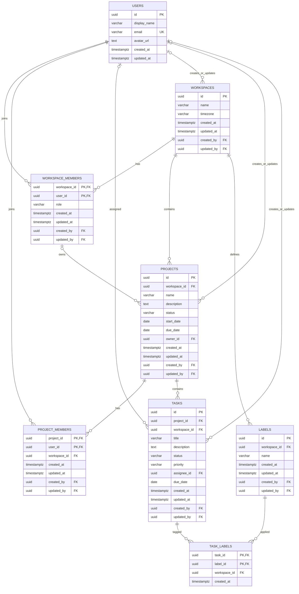

# Flow Application ERD

See the [Phase 2 schema proposal](DATABASE_DESIGN.md#phase-2-schema-proposal) for candidate relations and design decisions.

This Mermaid ERD reflects the baseline tables in `database/schema.sql`. It does not include optional activity events, authentication credentials, or cached dashboard aggregates.

Membership and label junctions have composite primary keys. Foreign-key delete behavior is restrictive; see `database/constraints.sql` for exact definitions.
